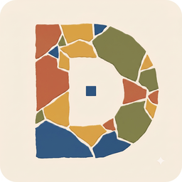

<p align="center">
  
</p>

# Diorna

Diorna is a local-first knowledge and productivity suite for Windows. It puts
notes, authored spatial maps, calendar and tasks, a keyboard-first daily grid,
structured sport training and progression, student study tools, and factual
monthly/yearly recaps in one private vault. Projects & Goals ties those modules
together around observable outcomes without duplicating their data.
Focus turns those outcomes, tasks and ideas into protected sessions with
planned/actual time, distraction capture and end-of-session reviews.

The application has no account, cloud service, analytics, crash reporting, or
telemetry. Markdown notes and Obsidian-compatible Canvas files remain portable
source data; SQLite provides the index and structured records.

## Status

This repository contains the Windows desktop application, migrations, import
and backup tooling, deterministic recap engine, remote OpenAI-compatible and
local Ollama summariser adapters, tests, and installer configuration. The
canonical specification is [product-specification.md](product-specification.md).

## Quick start

Prerequisites are Windows 10 1809 or newer, Node.js 22.17.0, npm 11.5.1, the
pinned Rust toolchain, Visual Studio Build Tools with the Desktop development
with C++ workload, and WebView2.

```powershell
npm ci
npm run dev
```

Run the desktop shell with `npm run tauri -- dev`. Run every local quality gate
with `npm run check`; browser acceptance tests use `npm run test:e2e`.

## Architecture and documentation

- [Architecture](docs/architecture.md)
- [Data model](docs/data-model.md)
- [Build and release](docs/build-release.md)
- [User manual](docs/user-manual.md)
- [Performance and NFR report](docs/nfr-report.md)
- [Beta and clean-machine checklist](docs/beta-checklist.md)
- [Contributing](CONTRIBUTING.md) and [CLA](CLA.md)
- [Security policy](SECURITY.md)

## Licence

Diorna is free software licensed under
[AGPL-3.0-only](https://www.gnu.org/licenses/agpl-3.0.html). Contributions also
require the copyright assignment in [CLA.md](CLA.md). Third-party attribution
is in [THIRD_PARTY_NOTICES.md](THIRD_PARTY_NOTICES.md) and is available from
Settings → About.
