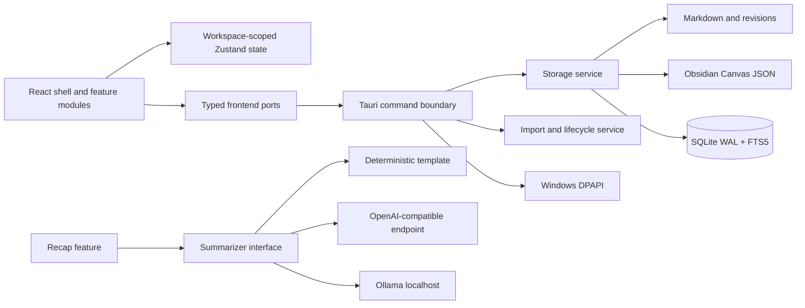

# Architecture

Diorna is a Windows-only Tauri 2 application. React renders the interface in
WebView2; Rust owns durable files, SQLite, imports, backups, OS integration,
secrets, and native exports. The vault is useful without the database and the
frontend remains useful without a summariser or network.

## Runtime boundaries

`src/components/AppShell.tsx` is the composition root. It owns navigation,
tabs, command palette, right-context composition, and lazy module loading.
Feature code lives in `src/modules/{notes,maps,calendar,daily,recap,student}`.
Pure rules live beside each module and have no React or native dependency.

`src/core/workspaceRepository.ts` binds a repository to one workspace when it
is constructed. It rejects foreign writes and never accepts an optional
workspace filter. The same invariant is repeated in SQLite through required
workspace columns, indexes, composite relationships, and query parameters.

`src/core/native.ts` is the frontend adapter for the Tauri command boundary.
Native services are split into `storage.rs`, `lifecycle.rs`, `secrets.rs`, and
`spreadsheet.rs`. Import and summarisation implementations are replaceable
without changing feature UI.

## Data flow and safety

Edits update local state optimistically. Notes autosave after at most 700 ms and
on teardown; the desktop adapter converts editor HTML to Markdown. Rust writes
a sibling temporary file, flushes it, then uses an atomic replace. Canvas JSON
is schema-validated before the same process. SQLite uses WAL and full sync.

Every note save creates a revision, pruned to the last 50 or 30 days. Search is
fed by FTS5. If the index is missing, startup reconstructs note and map metadata
from disk. Imports copy into a dated workspace folder and record an operation
manifest, making one-step undo possible.

## Network model

There is no telemetry. Outbound access is limited to a user-triggered remote
recap, optional update checks, and optional external-link handling. Remote
recaps default to aggregate statistics and show a consent preview. Ollama is
localhost. API keys are DPAPI-protected outside the vault.

## Error and accessibility model

The React error boundary prevents blank windows and exposes copyable
diagnostics. Rust commands use a serialisable domain error. Logs rotate locally.
All primary workflows have keyboard routes; CSS supplies visible focus,
high-contrast tokens, 200% responsive layouts, and reduced-motion handling.
